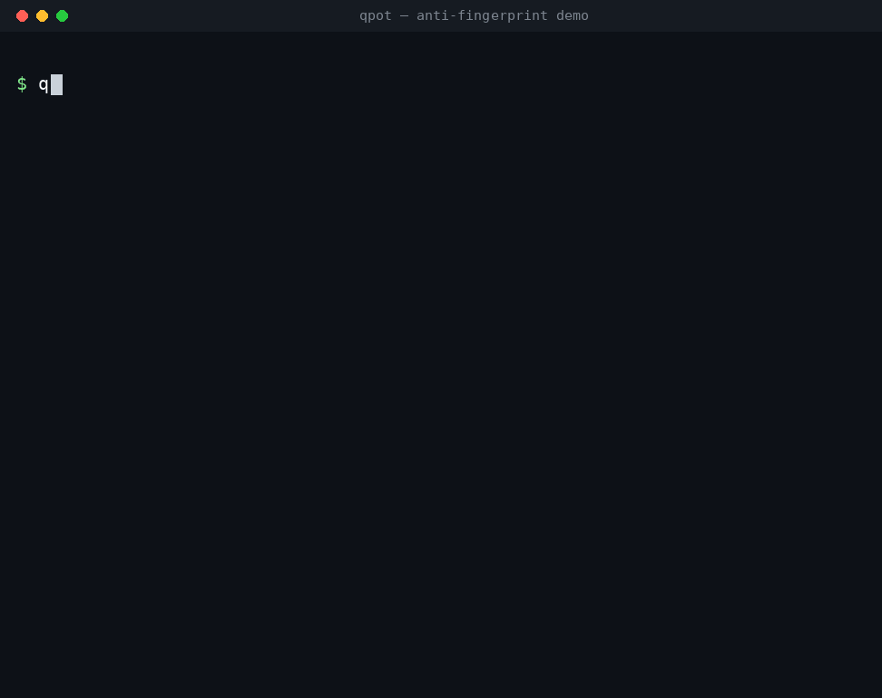

<p align="center">
  
</p>

<h1 align="center">QPot</h1>
<p align="center">
  <strong>Honeypot platform built on T-Pot, made harder to recognise</strong><br>
  <em>Developed by Yuril Security</em>
</p>

<p align="center">
  <a href="https://github.com/YurilLAB/QPot/releases"></a>
  <a href="https://golang.org"></a>
  <a href="https://docker.com"></a>
  <a href="LICENSE"></a>
</p>

QPot runs the same proven honeypot images as [T-Pot CE](https://github.com/telekom-security/tpotce),
driven by a single `qpot` binary. On top of T-Pot it adds:

- **Per-instance deception** – every deployment gets its own believable identity
  (SSH banner, kernel, hostname, users, filesystem) instead of T-Pot's
  globally identical defaults, plus an optional high-interaction mode backed by
  real OpenSSH.
- **Hardened containers** – per-honeypot networks, dropped capabilities,
  read-only filesystems, resource limits and gVisor/Kata when available.
- **Built-in analysis** – Vector → ClickHouse (or TimescaleDB), automatic
  MITRE ATT&CK tagging, IOC extraction, campaign (TTP) tracking and MISP export.
- **Canaries, alerts and response hooks**, multi-node **clusters**, and a
  built-in **web UI**: T-Pot's landing page and live attack map, restyled for
  QPot and served from QPot's own API, plus a dashboard.
- **One-command setup** that checks the host, starts everything and verifies it
  is actually healthy.

---

## Quick start

Install the `qpot` binary:

```bash
# Linux / macOS
curl -fsSL https://raw.githubusercontent.com/YurilLAB/QPot/main/scripts/install.sh | bash

# Windows (PowerShell)
irm https://raw.githubusercontent.com/YurilLAB/QPot/main/scripts/install.ps1 | iex

# Or from source (Go 1.26+)
git clone https://github.com/YurilLAB/QPot.git && cd QPot && make build
```

Set up and start an instance:

```bash
qpot setup                          # minimal: cowrie + endlessh
qpot setup --profile standard       # + dionaea, heralding, conpot, adbhoney
qpot setup --profile hifi --service # real-OpenSSH HiFi mode, as a systemd service
qpot doctor                         # re-check health any time (non-zero on failure)
```

`qpot setup` checks Docker, Compose, permissions, memory and disk; creates the
instance with a fresh QPot ID and random database password; makes sure the host
ports are free (a new instance whose web UI port is taken gets the next free
one); starts the containers and the control plane; and waits until the
database, collector, honeypots and this instance's web UI are healthy. The web
UI and database listen on `127.0.0.1` only, and nothing needs sudo. It also
downloads the free [DB-IP](https://db-ip.com) Lite country database so events
get a country and show on the attack map (`--no-geoip` skips it;
`qpot geoip update` refreshes it monthly). The map places the sensor from the
host's time zone; set it with `--country DE` if that is wrong or UTC.

The manual equivalent:

```bash
qpot instance create production
qpot up -d -i production    # containers + background control plane (qpot serve)
qpot down -i production
```

The **control plane** (web UI/API, intelligence worker, alerts, cluster
membership, HiFi backend recycler) runs inside `qpot up`, or in the background
as `qpot serve` with `-d` (log: `<instance>/logs/qpot-serve.log`).

### Web UI and API

Served by the `qpot` process on `http://127.0.0.1:8080` (or the port `setup`
chose), authenticated with the instance's **QPot ID** (`qpot id` shows it). From
another machine use an SSH tunnel: `ssh -L 8080:127.0.0.1:8080 <host>`.

| Page | What it is |
|------|------------|
| `/` | T-Pot's landing page in QPot's colours: status, 24h counts, links, MISP export |
| `/map/` | T-Pot's live attack map, fed by QPot's own database over an authenticated stream (`/api/map/stream`). The world is drawn locally (Natural Earth outlines), so the browser contacts no tile server. |
| `/dashboard` | Honeypot controls, intelligence and the overview |

The QPot ID is entered once per browser, checked with the server, kept in that
browser only and shown masked.

The dashboard shows live stats, per-honeypot controls, the attacker activity
feed, ATT&CK techniques / IOCs / campaigns (with a MISP export), cluster members
and the security posture. Its **Overview** tab adds host CPU / memory / disk /
process load, 24-hour activity per honeypot and the latest events with a
severity. The same view is available from the terminal, for one instance or all
of them on the host, and nothing is sent off the machine:

```bash
qpot overview          # this instance
qpot overview --all    # every instance on the host
```

---

## Honeypots

27 honeypots, using T-Pot's newest upstream images, `24.04.2` (there is no
T-Pot 25 release; tanner, snare and phpox stay on `24.04.1`, the newest
published for them). `qpot honeypot list` shows ports and risk levels:

`adbhoney`, `beelzebub`, `ciscoasa`, `citrixhoneypot`, `conpot`, `cowrie`,
`ddospot`, `dicompot`, `dionaea`, `elasticpot`, `endlessh`, `galah`, `go-pot`,
`h0neytr4p`, `hellpot`, `heralding`, `honeyaml`, `ipphoney`, `log4pot`,
`mailoney`, `medpot`, `miniprint`, `redishoneypot`, `sentrypeer`, `ssh-proxy`
(HiFi), `tanner`, `wordpot`.

`glutton` and `honeytrap` are left out on purpose: they need host networking and
`NET_ADMIN`, which would break QPot's per-honeypot isolation.

```bash
qpot honeypot enable dionaea   # starts it right away if the instance is running
```

`tanner` runs as T-Pot does: the snare web front end plus the tanner, API, PHP
sandbox and Redis containers on an internal network. `beelzebub` and `galah`
answer attackers with an LLM and need one before they are enabled:

```bash
qpot honeypot set galah llm_provider=ollama llm_server_url=http://10.0.0.5:11434 llm_model=llama3.1
qpot honeypot set beelzebub llm_provider=ollama llm_model=llama3.1 llm_host=http://10.0.0.5:11434/api/chat
qpot honeypot enable galah
```

---

## Deception



A stock T-Pot install is recognisable because every install is identical. QPot
gives each instance a distinct, self-consistent identity:

- **Cowrie personas** – cowrie runs as one of the persona engine's machines in
  the T-Pot cowrie image (Ubuntu 24.04/22.04, Debian 13/12, RHEL 9, CentOS 7,
  Raspberry Pi OS, a GPU server, and routers, NAS boxes and an IP camera). The
  engine builds the whole box from the persona: the OpenSSH release with that
  release's key-exchange and host-key lists, `uname` and `/proc`, a process
  table whose start times match the uptime, `lscpu`/`lspci`/`mount`/`df`, the
  network behind `ip`/`ss`/`netstat`, the packages behind `dpkg`/`rpm`, the
  units behind `systemctl` and the `sudo` rules. QPot picks a server persona per
  instance and keeps the identity it draws (host name, patch level, boot time,
  addresses) for a year across restarts, so a returning attacker meets the same
  box. Pin one with `qpot honeypot set cowrie persona=<id>`.
- **Conpot devices** – conpot emulates one of the T-Pot conpot image's devices
  (a Siemens substation RTU on IEC 104/DNP3/SNMP, a Veeder-Root tank gauge, a
  Supermicro BMC, a Kamstrup meter, a Beckhoff PLC on ADS/OPC UA, a LOYTEC
  building controller on BACnet/KNX, an Emerson HART gateway, an ICCP server or
  a Modicon PLC on Modbus), picked per instance. It publishes only that
  device's ports, and the address, MAC, serials and PINs the image draws for it
  are kept across restarts. The image's multi-protocol `default` template, the
  same on every install, is never used. Pin one with
  `qpot honeypot set conpot template=<id>`.
- **Heralding personas** – heralding answers every service as the machine its
  persona describes (Ubuntu, Debian, RHEL or Windows Server): FTP, SSH, SMTP,
  POP3 and IMAP greetings, web server header and certificate subject agree.
  QPot runs it with the image's configuration minus the stock greetings that
  overrode the persona (`OpenSSH_6.6.1p1 Ubuntu-2ubuntu2.8`, "Microsoft FTP
  Server", Exchange SMTP), and keeps the persona, its certificates and SSH host
  keys across restarts.
- **ADB device** – adbhoney introduces itself as one Android 8 phone picked per
  instance (Pixel 2, Mi A1, Galaxy S9, …) in the form a real adbd uses, instead
  of the stock `device::http://ro.product.name =starltexx` banner every ADBHoney
  install sends. Files pushed with `adb push` are kept in its `dl` directory.
  Fetching URLs from attacker commands is off: the image's downloader would
  request any address, including ones on your own network.
- **HiFi credential personas** – the real-OpenSSH backends of HiFi mode accept a
  persona's believable weak passwords (30 personas: corporate Ubuntu, DB
  server, Proxmox host, …) under a matching host name. Pin one with the
  ssh-proxy's `credential_template`.
- **No giveaways** – container environments contain no `qpot`/`tpot`/`honeypot`
  strings and no stealth knobs: an intruder who reads `/proc/1/environ` finds
  nothing that names a honeypot. The config files QPot mounts are the images'
  own formats and are not reachable from an attacker's session.

**Limitation:** cowrie's cipher and MAC lists and its packet handling come from
its Python SSH stack, so a determined packet-level fingerprinter can still tell
it from real OpenSSH. **HiFi mode** closes that gap: a transparent TCP broker (`ssh-proxy`)
passes the attacker straight to real OpenSSH backends on an egress-blocked
network, and each backend is recreated after every session. Enable it with
`qpot setup --profile hifi` or `qpot honeypot enable ssh-proxy`. Details:
[doc/ssh-hifi-proxy.md](doc/ssh-hifi-proxy.md) and
[doc/fingerprint-comparison.md](doc/fingerprint-comparison.md).

```bash
qpot honeypot set cowrie persona=debian-bookworm   # optional; picked per instance if unset
qpot honeypot set cowrie persona_rotation=30       # days to keep the drawn identity (0-365, default 365)
qpot honeypot set conpot template=plc_modbus       # optional; picked per instance if unset
```

---

## Data and threat intelligence

Vector collects every honeypot's JSON log, normalises it (source IP/ports,
protocol, event type, credentials, commands, download URLs; each honeypot's own
field names are mapped as T-Pot's Logstash pipeline does), adds the attacker's
country from the GeoIP database and writes it to the instance database. Lines
without an attacker address (startup banners, errors) are dropped. Data is kept
for 90 days.

| Backend | Notes |
|---------|-------|
| `clickhouse` | Default. Runs as the instance's `database` container. |
| `timescaledb` | Supported alternative (`database.type: timescaledb`). |

The intelligence worker (every 15 minutes by default,
`intelligence.worker_interval`) then:

- **Classifies** each event with MITRE ATT&CK – 16 curated rules plus rules
  generated from the ATT&CK dataset (fetched from MITRE, embedded fallback when
  offline), each with a confidence score. Example: `uname -a` → T1082,
  `wget …` → T1105, failed logins → T1110, Modbus probes → T0840.
- **Extracts IOCs** – public attacker IPs, credential pairs, URLs and domains,
  file hashes (including downloaded payloads), crypto wallets, commands and user
  agents. Defanged indicators (`hxxp://`, `1.2.3[.]4`) are refanged first.
- **Groups campaigns (TTP sessions)** by shared credentials, tooling, commands
  and targeted services rather than IP alone.

| Endpoint | Description |
|----------|-------------|
| `GET /api/techniques` | Observed ATT&CK techniques with counts |
| `GET /api/iocs` | IOCs, filterable by type and honeypot |
| `GET /api/iocs/export?format=misp` | IOCs as a MISP event |
| `GET /api/ioc` | Attacker IP blocklist |
| `GET /api/ttps` | Campaign sessions |
| `GET /api/intelligence` | Summary |

Optional extras: Suricata/p0f/fatt sensor ingest (`collector.ingest_*`), a
MaxMind database instead of DB-IP (`collector.geoip_db_path`, any MaxMind-format
file), and Kibana on top of ClickHouse via the bundled connector in
[docker/clickhouse-kibana](docker/clickhouse-kibana/README.md).

---

## Canaries

Canaries are decoy artifacts you plant inside your real environment – a fake AWS
key in a CI runner, a document on a file share, a beacon URL in a config file.
Nobody should ever touch them, so a trip is a critical, near-zero-false-positive
alert.

```bash
qpot canary create --kind aws  --name ci-runner --memo "planted in Jenkins"
qpot canary create --kind file --name q4-salaries
qpot canary trips
```

`web`/`file` canaries trip when their beacon URL (`/c/<token>`, set
`canary.base_url` to where this QPot is reachable) is fetched; `aws` canaries
trip when the key shows up in a captured honeypot session. See
[docs/canary.md](docs/canary.md).

---

## Alerts and response hooks

```yaml
alerts:
  enabled: true
  webhook_url: https://hooks.slack.com/services/...   # Slack, Discord or any URL
  threshold: 100      # events per minute
  cooldown: 5m

response:
  enabled: true
  on_attack_detected:
    - name: block-top-attacker
      command: 'iptables -I INPUT -s "$QPOT_TOP_SOURCE_IP" -j DROP'
      timeout: 10s
```

Hooks get `QPOT_ID`, `QPOT_INSTANCE`, `QPOT_TOTAL_EVENTS`, `QPOT_UNIQUE_IPS`,
`QPOT_THRESHOLD`, `QPOT_TIMESTAMP`, `QPOT_TOP_SOURCE_IP` and
`QPOT_TOP_HONEYPOT` as environment variables (never interpolated into the
command) and run with a timeout in their own process group.

---

## Clusters

Pair several QPot nodes into a group that shares health and attacker data:

```bash
qpot cluster init --name production                      # prompts for a password, prints the cluster ID
qpot cluster join --id qc_... --password '...' --seed 10.0.0.10:7946   # on each sensor
qpot cluster requests --password '...'                   # on the host: pending joiners
qpot cluster approve <request-id> --password '...'       # (or deny)
qpot cluster status
```

Joining needs the password **and** the host's approval (`require_approval`,
on by default). Traffic between nodes is TLS-encrypted automatically – the
cluster CA is derived from the cluster ID and password, so there are no
certificates to manage. Membership runs in the control plane, so restart
`qpot up -d` after `init`/`join`. The password is stored in
`~/.qpot/cluster/cluster.secret` (0600) or read from `QPOT_CLUSTER_PASSWORD`.

---

## Security model

| Area | What QPot does |
|------|----------------|
| Isolation | Each honeypot on its own bridge network with a non-overlapping subnet |
| Egress | Honeypots cannot open connections to your LAN, the Docker host, cloud metadata (`169.254.169.254`) or any other private, loopback, link-local, CGNAT or multicast address. Replies to attackers, public destinations and DNS to the host's resolvers still work. An nftables guard (`netguard` service, host network, `NET_ADMIN` only) enforces it, and honeypots start only after it is in place |
| Runtime | gVisor or Kata used for honeypots when installed |
| Containers | `cap_drop: ALL` (minimal add-backs), read-only root with tmpfs, no privileged containers |
| Limits | CPU, memory, PID and file-descriptor limits per honeypot |
| Secrets | QPot ID never given to honeypot containers or written to logs; DB password random per instance |
| Exposure | Web UI, API and database bound to `127.0.0.1` by default |
| Web | CSP, `X-Frame-Options: DENY`, `nosniff`, constant-time auth checks |
| HiFi backends | No outbound network, recreated after every session, read-only host keys |

---

## Configuration

Each instance has a `config.yaml` (`qpot config -i <name> --print` shows the
path). Commonly changed settings:

```yaml
web_ui:
  port: 8080
database:
  type: clickhouse            # or timescaledb
honeypots:
  cowrie:
    enabled: true
    resources:
      use_custom_limits: true
      max_cpu_percent: 30
      max_memory_mb: 256
      max_pids: 50
intelligence:
  worker_interval: 15m
security:
  network_isolation:
    block_outbound: false        # true: honeypots open no outbound connections at all
    allow_private_egress: false  # true: switch the egress guard off (not recommended)
```

The egress guard runs where Docker's bridges live: the host itself on Linux,
Docker Desktop's VM on Windows and macOS. Its rules outlive a stopped stack
until the next reboot, and the `netguard` service applies them again whenever
it starts (Docker restarts it with the honeypots after a reboot).

---

## CLI

```bash
qpot setup | doctor | up [-d] | serve | down | status   [-i <instance>]
qpot instance create|list|remove <name>
qpot honeypot list|enable|disable <name>   qpot honeypot set <name> key=value
qpot geoip update [--country CC]
qpot logs [honeypot] [-f]          qpot id          qpot config [--print]
qpot docker ps|logs|restart        qpot db migrate status|up|down
qpot cluster ...                   qpot canary ...  qpot overview [--all]
```

Every command has `--help`; the full reference is
[doc/cli-reference.md](doc/cli-reference.md). Most commands take
`-i/--instance` (default `default`).

**Dedicated sensor hosts:** `sudo ./install.sh` runs the T-Pot-style Ansible
installer (AlmaLinux, Arch, Debian, Fedora, openSUSE, RHEL, Rocky, Ubuntu, …).


---

## Development

```bash
make build      # build ./qpot
make test       # unit tests
make ci         # fmt, vet, lint, test, security checks
make build-all  # cross-compile
```

```
cmd/qpot/            CLI and control plane
cmd/qpot-sshproxy/   HiFi SSH broker
internal/
  instance/          compose + collector generation, deception, lifecycle
  intelligence/      ATT&CK classifier, IOC extractor, TTP sessions, worker
  database/          ClickHouse, TimescaleDB (and Elasticsearch client)
  server/            web UI and API
  overview/          local host + activity overview (dashboard, API, CLI)
  cluster/ canary/ proxy/ security/ config/
docker/              honeypot images, ssh-proxy/ssh-backend, Kibana connector
```

CI runs build, gofmt, vet, staticcheck, race tests, fuzzing, govulncheck,
gosec, gitleaks and a multi-distro smoke test on every push.

---

## License

GPL-3.0 – see [LICENSE](LICENSE). QPot builds on
[T-Pot CE](https://github.com/telekom-security/tpotce) by Deutsche Telekom
Security (GPL-3.0). Issues: [GitHub Issues](https://github.com/YurilLAB/QPot/issues).

<p align="center"><strong>Built by Yuril Security</strong><br><em>Australian-made cybersecurity</em></p>
