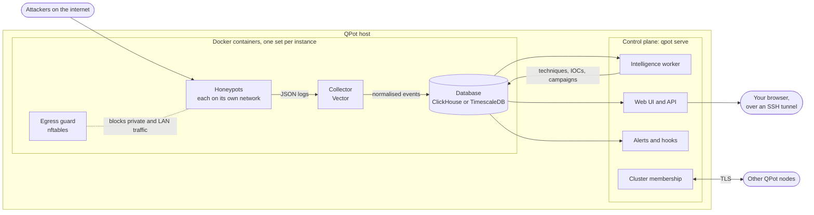

# Architecture

This page explains how QPot is put together: what runs where, how an attack
becomes data on the dashboard, and how the pieces are kept apart.

## The big picture

QPot is a single program, `qpot`, that builds and runs a honeypot stack on top
of Docker. It uses the same honeypot images as T-Pot, but generates its own
Docker Compose file for every instance, adds its own collector, database and
egress guard, and runs a control plane next to the containers.

## Instances

An instance is one complete deployment: its own honeypots, settings, database,
web UI port and QPot ID. Several instances can run on one host side by side,
and QPot picks ports and subnets so they do not collide.

Each instance lives in its own folder, normally `~/.qpot/instances/<name>`,
which holds:

- `config.yaml`, the instance's settings;
- `docker-compose.yml`, generated from the settings and never edited by hand;
- a folder per honeypot with its logs, captured files and kept identity;
- the control plane's log.

When a setting changes, through the CLI or the web UI, QPot rewrites the
Compose file and recreates only the containers that changed.

## The containers

**Honeypots.** Each enabled honeypot runs from T-Pot's upstream image. Every
honeypot gets its own Docker bridge network with a subnet of its own, drops all
Linux capabilities except the few it needs, runs with a read-only root
filesystem, and has CPU, memory and process limits. When gVisor or Kata
Containers is installed, honeypots run inside it.

QPot never rebuilds the images. Where an image needs to behave differently, for
example Cowrie's shell commands, QPot mounts corrected source files read-only
over the image's own. Each mounted file is tied to the exact image version
and to a hash of the original it replaces, so a new image version means the
patches are checked again before they are used. See
[deception.md](deception.md).

**Egress guard.** The `netguard` container installs nftables rules on the
host before any honeypot starts. Honeypots may answer attackers and reach the
public internet, but they cannot open connections to your local network, the
Docker host, cloud metadata services or any other private address. See
[security.md](security.md).

**Collector.** Vector reads every honeypot's log files, read-only, and turns
each honeypot's own format into one common event: who connected, from where,
to which honeypot and port, and what they sent, such as credentials, commands
and download links. It adds the attacker's country from the local GeoIP
database and writes the events to the database. It sees only the honeypot,
sensor and GeoIP folders, its backup folder and its own state folder, never
the rest of the instance folder: the logs it parses are written by attackers,
and a compromised honeypot could plant a link in its logs folder pointing at a
secret.

The collector records how far it has delivered each log, in the instance's
`collector` folder, and moves that mark only once the database and the backup
have stored the lines. While the database is away it waits, however long, and
the lines stay in the honeypot's log. A collector that restarts or is
recreated reads again whatever it had not delivered, and a log it has never
seen from its start. The first time it keeps this state, QPot marks what the
logs already hold as delivered, so nothing is sent twice. Every event carries
an ID derived from its log line, and the events table drops an insert block
it has already stored, so a batch the collector has to send again after a
timeout is stored once.

**Database.** ClickHouse by default, or TimescaleDB. It sits on an internal
Docker network that honeypots cannot reach, and is published on the host only
on `127.0.0.1`. Events are kept for 90 days. The database and collector images
are pinned to tested versions, like the honeypot images.

**HiFi mode.** With the `hifi` profile, an SSH broker accepts attackers and
passes each connection to a real OpenSSH server on a network with no outbound
access. A visitor keeps its server across its connections and for 30 minutes
after (by default); the server is then thrown away and recreated.
Their own sshd records the sessions on the container's log stream; nothing
inside the server records or is mounted from the host.
See [ssh-hifi-proxy.md](ssh-hifi-proxy.md).

## The control plane

The control plane is the `qpot` program itself, running as `qpot serve`, or
inside `qpot up`. It is not a container: it runs on the host as your user.

- **Web UI and API.** T-Pot's landing page and attack map, restyled for QPot,
  and a dashboard for everything QPot adds. The attack map receives live
  attacks as a server-sent event stream. Every request must carry the
  instance's QPot ID. See [web-ui.md](web-ui.md) and [api.md](api.md).
- **Intelligence worker.** Every 5 minutes it reads new events, tags them
  with MITRE ATT&CK techniques, extracts indicators of compromise and groups
  related activity into campaigns. It checkpoints its work, so a crash never
  counts an observation twice. See [intelligence.md](intelligence.md).
- **Disk cleanup.** Two minutes after start and every hour, it removes old
  captured files, rotated logs and backup days, empties collected logs above
  their limit and keeps each honeypot's folder under its storage limit. See
  [disk-cleanup.md](disk-cleanup.md).
- **Canary matcher.** It watches captured events for the values of your
  canaries, including the bait planted inside the honeypots, and raises a
  critical alert when one is used. See [canary.md](canary.md).
- **Alerts and response hooks.** When attack volume crosses a threshold it
  posts to a webhook and can run your own commands. See [alerts.md](alerts.md).
- **Cluster membership.** It keeps this node in touch with the other nodes of
  its cluster over TLS. See [clustering.md](clustering.md).
- **HiFi recycler.** It recreates each HiFi backend when the broker reports
  that its visitor let go of it.
- **HiFi session capture.** It turns each HiFi backend's session capture into
  per-command evidence files on the host, joined to the broker's connection,
  and converts what a backend still holds before anything removes it.

## From an attack to the dashboard

1. An attacker connects to a honeypot port on the host. Docker forwards the
   connection to the honeypot's container.
2. The honeypot answers as the machine its persona describes, and writes what
   happened to its JSON log.
3. The collector picks up the new log lines within seconds, normalises them,
   adds the country and stores them as events.
4. The attack map shows the event almost at once, and the landing page's
   counters and timeline update on their next refresh.
5. On its next run, the intelligence worker classifies the event, extracts its
   indicators and updates the campaigns it belongs to.
6. If the event used a canary value, the canary matcher raises a critical
   alert, and webhooks and hooks run as configured.

## Clusters

Several QPot nodes can form a cluster to share each node's health. The
node that created the cluster acts as its certificate authority and is the
only one that can admit new members. Each node holds its own private key and
certificate, and every connection between nodes is TLS, checked against the
cluster ID. See [clustering.md](clustering.md).

## Source layout

| Folder | What it holds |
|---|---|
| `cmd/qpot` | The CLI and the control plane |
| `cmd/qpot-sshproxy` | The HiFi SSH broker |
| `internal/sshcapture` | Turns HiFi backends' session capture into evidence files |
| `internal/instance` | Compose and collector generation, deception, instance lifecycle |
| `internal/hostsetup` | Guided setup, Docker installation and the coded error catalogue |
| `internal/server` | The web UI and API |
| `internal/intelligence` | ATT&CK classifier, IOC extractor, campaigns and the worker |
| `internal/database` | ClickHouse and TimescaleDB, and an Elasticsearch client |
| `internal/cluster` | Cluster membership, enrollment and TLS |
| `internal/netguard` | The egress guard's rules |
| `internal/canary` | Canaries and their trips |
| `docker/` | Honeypot images, the HiFi broker and backend, the Kibana connector |

Building and testing are covered in [development.md](development.md).
