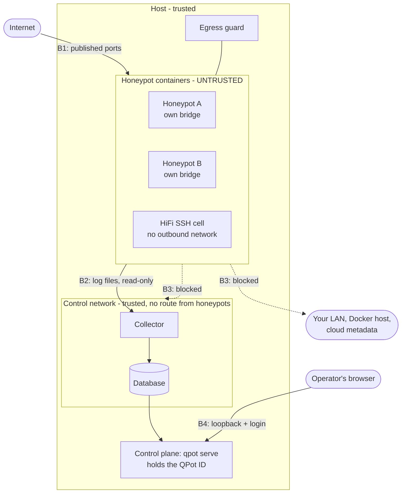

# Threat model

QPot invites attackers onto a machine you own. This page says who QPot
defends against, what it protects, where the boundaries are, and what it does
not defend against. [security.md](security.md) describes the controls
themselves; this page says what each one is for.

- [What is protected](#what-is-protected)
- [Who attacks](#who-attacks)
- [Trust boundaries](#trust-boundaries)
- [Threats and what answers them](#threats-and-what-answers-them)
- [What QPot does not defend against](#what-qpot-does-not-defend-against)
- [Assumptions](#assumptions)
- [Checking the model against the code](#checking-the-model-against-the-code)

## What is protected

In the order QPot gives up the others to keep:

1. **Your host and network.** The computer QPot runs on, the network it is
   attached to, and the cloud account it may run in. A honeypot must never
   become a way into them.
2. **Other people.** A honeypot must not become a tool for attacking third
   parties: no open relay, no amplification, no scanning from your address.
3. **The evidence.** What attackers did, as recorded: complete, not
   duplicated, and attributed to the right visitor.
4. **The management credential** (the QPot ID) and the other secrets of an
   instance: the database password, cluster keys, canary tokens.
5. **The deception.** That the honeypots keep looking like real systems.
   Losing it costs data, never safety, so it ranks last.

## Who attacks

| Actor | Starts with | Wants |
|---|---|---|
| **Internet visitor** | A connection to a honeypot port. This is every scanner, bot and intruder QPot exists to observe. | To use the machine: run code, pivot, mine, relay, or find out that it is a honeypot. |
| **Intruder inside a honeypot** | Code execution in one container, as that container's user. Assumed to happen: honeypot software is old on purpose, and HiFi SSH gives a real shell by design. | To leave the container, reach the host, the LAN, cloud metadata or the other containers, or to poison the evidence. |
| **Network peer** | A position on the host's network or the internet path to it. | To reach the web UI, the API, the database or a cluster port. |
| **Local user** | An unprivileged account on the QPot host. | To read the QPot ID or the evidence, or manage the instance. |
| **Malicious cluster peer** | A QPot node admitted to the cluster, or its stolen key. | To feed false status to the cluster or learn about other nodes. |
| **Supply chain** | Control of something QPot downloads: a release archive, an image, a Go module, the ATT&CK data. | To run code on the host. |

Out of scope as attackers: the operator, anyone with root on the host, and
anyone who can change the Docker daemon. They own the machine already.

## Trust boundaries

| Boundary | What crosses it | How it is held |
|---|---|---|
| **B1** Internet to honeypot | Any bytes an attacker sends | Only the honeypots' ports are published. Everything behind them is treated as hostile from here on. |
| **B2** Honeypot to collector | Log files the honeypot writes | The collector mounts the log folders read-only and nothing else of the instance. Every field of a log line is data: QPot's own fields (honeypot name, sensor ID, timestamp, classification) are set after the line is parsed and cannot be supplied by it. |
| **B3** Honeypot to everything else | Nothing, by design | Container hardening, a sandbox runtime, a bridge per honeypot and the egress guard. See below. |
| **B4** Operator to control plane | API requests | Loopback by default, a login always, no start without a login on any other address. |
| **B5** Node to node | Cluster status over TLS | Certificates signed by the cluster's CA, which only the enrolling host holds. |
| **B6** Downloads to host | Release archives, images, modules | Checksums, provenance, digests pinned in the source. |

The control plane runs on the host as the operator's user, not in a
container, and is the only component that holds the QPot ID.

## Threats and what answers them

Each row names the test or check that fails if the answer stops being true.

### An intruder inside a honeypot (boundary B3)

| Threat | Answer | Enforced by |
|---|---|---|
| Escapes the container through the kernel | gVisor or Kata is required by default; a missing or mismatched runtime stops the start. Real-execution honeypots never fall back to the standard runtime. | `security.sandbox_mode`, QP-DOCKER-010/011/012; `TestSandbox*` |
| Raises privileges inside the container | All capabilities dropped, no-new-privileges, read-only root, non-root image users. Cannot be switched off. | `config.MandatoryControls`; `TestMandatoryContainmentCannotBeSwitchedOff` |
| Reaches the LAN, the Docker host or cloud metadata | The egress guard drops traffic from honeypot bridges to private, loopback, link-local, CGNAT and multicast addresses and to the host itself. Honeypots start only once it is in place. | `internal/netguard`; `TestGuardOffRefusesSensitiveStart`; QP-INST-015 |
| Reaches another honeypot, the collector or the database | One bridge per honeypot; the database and collector sit on an internal network no honeypot joins. | `TestMandatoryContainmentCannotBeSwitchedOff` |
| Attacks third parties from your address | `block_outbound: true` removes all outbound connections; HiFi cells have none at all. With the default, honeypots that fetch what an attacker asks for (cowrie's `wget`) can reach public addresses. This is a deliberate trade for capturing payloads. | `security.network_isolation` |
| Exhausts the host (fork bomb, memory, disk) | CPU, memory, swap and PID limits per container, verified with Docker before a sensitive workload starts; disk cleanup keeps each honeypot's folder under its limit. | QP-RES-005/007; `TestSensitiveWorkloadsNeedEnforcedLimits`; [disk-cleanup.md](disk-cleanup.md) |
| Reads the QPot ID or the database password | No container is given the QPot ID. Honeypots get no database credentials and cannot reach the database. | `TestGeneratedFilesNeverCarryTheQPotID` |
| Plants a symlink in its logs folder to make the collector or cleanup read or delete host files | The collector sees only log folders, read-only. Cleanup acts inside each mounted folder through a rooted file handle and never follows a link out. Nothing is mounted inside a writable mount. | `TestNoMountInsideAWritableMount`; `internal/cleanup` |
| Forges log lines to frame another address, fake a classification or hide | Log content is recorded as the honeypot's claim. The honeypot name comes from the file's path, classification fields are deleted on ingest, and HiFi sessions are attributed by the broker's own connection record, not by anything the guest writes. | `TestVectorRemapLive`; `internal/sshcapture` |
| Floods logs to push earlier evidence out | The collector delivers before cleanup may empty a log. HiFi capture is charged against per-connection budgets. A sustained capture outage can still lose HiFi output: see [reliability.md](reliability.md). | `internal/vectorstate`; `TestSSHBackendCaptureCostLive` |

### A network peer or local user (boundary B4)

| Threat | Answer | Enforced by |
|---|---|---|
| Uses the API without a credential | The QPot ID (or Basic authentication) is checked on every API route in constant time. With no login configured the control plane refuses to listen anywhere but loopback. | `TestAuthMatrixOverTheHandlerChain`, `TestStartRefusesLoginlessExposure`; QP-WEB-005 |
| Learns the QPot ID from somewhere it was written | It is accepted only in a header, never returned by the API, never in alerts or cluster traffic, never in events, backups, container environments or generated files, and printed by `qpot up` only on a terminal. | `TestGeneratedFilesNeverCarryTheQPotID`, `TestVectorKeepsScannerEvidenceLive`, `TestStaticIndexDoesNotLeakQPotID`; QP-INST-016 |
| Makes the operator's browser act for them (CSRF, XSS) | State-changing requests must be JSON, which a cross-site form cannot send; a strict Content-Security-Policy; attacker-controlled strings are inserted as text, never as markup. | `csrf_test.go`, `TestSecurityHeaders` |
| Reaches the database directly | Published on `127.0.0.1` only, with a random password per instance. | compose template |
| A local user reads the instance | The instance folder and its secrets are private to the operator's account. A local user who can talk to Docker is root already. | file modes in `internal/instance` |

The web UI speaks plain HTTP. On loopback that is the operator's own
machine; across a network it must go through an SSH tunnel or a TLS proxy.

### Evidence integrity

| Threat | Answer | Enforced by |
|---|---|---|
| Events lost while the database or collector is down | The collector acknowledges a line only once the database and the backup have it, and reads on from that mark after any restart. | `internal/soak`; [reliability.md](reliability.md) |
| Events stored twice when an insert is retried | Each event's ID is derived from the file, the byte offset and the text of its log line, so a retried batch is the same batch. ClickHouse drops a block it already holds; on TimescaleDB a unique index on ID and time refuses the second copy. | `TestClickHouseStoresARetriedBatchOnce`, `TestPGIngestStoresARetriedBatchOnce`, `TestPGHypertableStoresARetriedBatchOnce`; `internal/soak` |
| A log line read twice is counted as two events | A collector that lost its checkpoints, or was killed between delivering a batch and noting it, reads lines again. They arrive with the ID of the rows already stored. The intelligence worker deletes such a second copy before it counts anything, and never the only copy. | `TestVectorEventIdentityLive`, `FuzzPlanReplays`, `TestClickHouseRemovesReplayedEvents`, `TestWorkerDoesNotCountAReplayedEvent`; the soak's `collector-amnesia` fault |
| Two separate visits that wrote the same line are counted as one | The ID includes the byte offset the line starts at, so equal lines in one file are different events. | `TestVectorEventIdentityLive` |
| A honeypot accepts connections it cannot record | The disk guard stops every honeypot before the disk is full and starts them again when there is room; `qpot up` refuses to start on a disk below the floor (QP-RES-008). | `internal/diskguard`, `internal/server/diskguard_test.go`; the soak's `disk-low` fault |
| The database is lost | The collector's log backups hold every event with its ID. `qpot db restore` rebuilds the events from them, storing nothing twice, and the worker rebuilds indicators and sessions. | `TestRestoreBackups`, `TestClickHouseRestoreEvents`, `TestPGRestoreEvents`; [release.md](release.md#rebuilding-the-database-from-log-backups) |
| Events or intelligence counted twice after a crash or a worker takeover | The intelligence worker commits each batch with its checkpoint, holds a fenced database lease, and a worker that lost the lease cannot write. | `worker_lease_test.go`, `worker_retry_test.go`; `internal/soak` |
| Evidence discarded before it is stored | Nothing between the logs and the database drops an event for its content. Scanner traffic is tagged, not removed. | `TestScannerEventsAreNeverFiltered`, `TestVectorKeepsScannerEvidenceLive` |
| Unrelated attackers merged into one campaign | A session is one source. Sources are linked only by a shared payload, download host or command sequence, never by one common command. Confidence reflects that evidence, not volume. | `ttp_test.go`; [intelligence.md](intelligence.md) |
| Every visitor appears as one source | Where Docker forwards connections from its own address, the collector marks the events. They are never attributed to that address: a session is then one honeypot connection, by the honeypot's own session ID. `qpot doctor` reports the share of marked events (QP-NET-015). | `TestVectorMarksSharedSourceLive`, `TestSharedSourceIsNotOneSession`, `TestSourceAddressCheck` |

### Cluster and supply chain (boundaries B5, B6)

| Threat | Answer | Enforced by |
|---|---|---|
| An unknown node joins, or a removed one returns | Only CA-signed certificates are admitted; the CA key stays on the enrolling host; removed nodes are remembered. | [clustering.md](clustering.md); `internal/cluster` tests |
| A tampered release or installer download | The installers verify SHA256SUMS and GitHub build provenance and refuse redirects off GitHub's release servers. Release builds are reproducible from the tagged commit. | [installation.md](installation.md), [release.md](release.md) |
| A changed image under the same tag | The database and collector images are pinned by digest; honeypot images by T-Pot release tag, and every file QPot mounts over an image is tied to a hash of the original it replaces. | `TestCIClickHouseImageMatchesCompose`; `*_patch_test.go` |
| A vulnerable dependency or a leaked secret reaches a release | CI runs govulncheck, gosec, CodeQL with pinned queries and reviewed findings, and Gitleaks over the tree and the release archives; any of them failing stops publication. | `.github/workflows` |

## What QPot does not defend against

Stated plainly, so nobody relies on it:

- **A kernel or hypervisor exploit under `sandbox_mode: none`.** On Docker's
  standard runtime the container boundary is the host kernel. Docker Desktop
  can only run this way. Use a dedicated VM.
- **A gVisor or Kata escape.** They shrink the kernel surface; they are not
  proof. A sensor exposed to the internet belongs on a host with nothing
  else on it.
- **Abuse of allowed outbound traffic.** Unless `block_outbound` is set, a
  honeypot that downloads for the attacker can be made to send requests to
  public addresses.
- **Being recognised as a honeypot.** The limits are listed in
  [deception.md](deception.md) and
  [fingerprint-comparison.md](fingerprint-comparison.md). A recognised
  honeypot yields less data; it is not less contained.
- **Denial of service against the honeypots themselves.** Limits protect the
  host. An attacker can still fill a honeypot's connection slots.
- **An attacker with the QPot ID.** It is a bearer credential with full
  control of the instance. People who only need to look can be given a key
  with a lesser role instead ([security.md](security.md#team-access-keys-with-roles)),
  but a member's key is a bearer credential too: whoever holds a viewer's
  key reads everything the instance captured, and whoever holds an admin's
  key controls it through the web API.
- **Network attackers when the web UI is bound off loopback without TLS.**
  The login then crosses the network in clear text.
- **Root on the host, the Docker daemon, or the operator.**
- **Truth of what a compromised honeypot logs.** QPot records which honeypot
  wrote a line and when, and keeps a guest from writing QPot's own fields.
  It cannot tell whether the honeypot software itself was made to lie.
- **Who connected, where Docker hides it.** On Docker Desktop, rootless
  Docker, a daemon without its packet-filter rules, or behind a proxy that
  rewrites the source, every visitor arrives from one address. QPot says so
  and attributes nothing; it cannot recover the real address. See
  [release.md](release.md#source-addresses).
- **A disk filled faster than the guard looks.** The disk guard reads the
  free space every five seconds and acts at a floor of 512 MB by default. If
  something else fills the last 512 MB within those seconds, a honeypot can
  accept connections it cannot log until the guard has stopped it.
- **Evidence older than the log backups, once the database is gone.**
  Restoring rebuilds only the days the backups still hold.

## Assumptions

The answers above hold only while these do:

1. The host kernel, Docker and the sandbox runtime are patched.
2. The host's user accounts and the Docker socket are not shared with
   untrusted people.
3. nftables works on the host (the egress guard checks, and refuses to
   report healthy otherwise).
4. The instance folder stays on a local filesystem private to the operator.
5. Time on the host is roughly right (certificates, leases, retention).

## Checking the model against the code

The tests named in the tables are the model's teeth. Two more checks cover it
as a whole:

- `qpot doctor -i <name>` reports, for a running instance, the observed
  container runtime, the limits Docker enforces, the containment settings,
  the web UI's login and whether any stored file still carries the QPot ID.
- The failure soak (`internal/soak`) breaks the database, the collector, the
  network between them, the honeypot and the control plane under traffic
  and counts lost and duplicated evidence. Its last recorded results are in
  [reliability.md](reliability.md).

A change that weakens a row here should fail the test named in it. If it
does not, the test is the bug: please report it as described in
[security.md](security.md#reporting-a-vulnerability).
