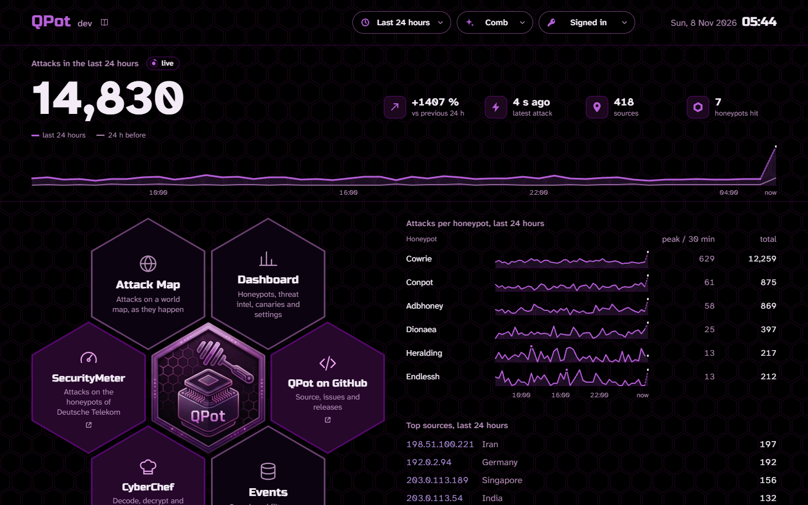
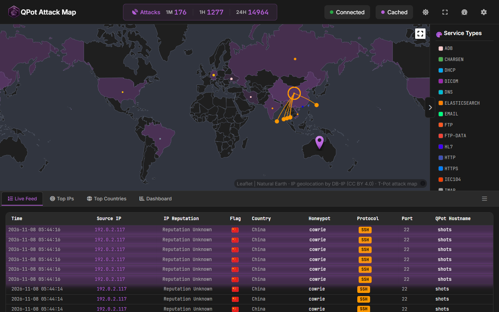
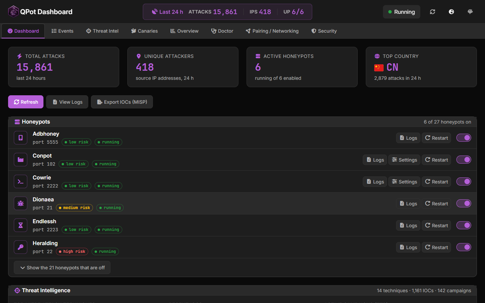
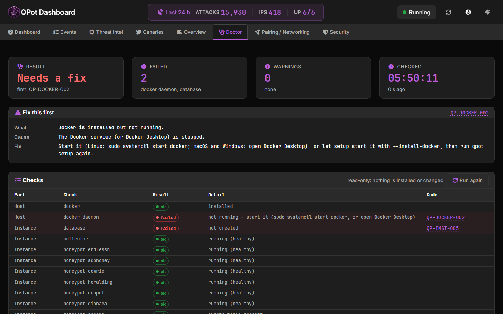

# Web UI

The `qpot` control plane serves the web UI on `http://127.0.0.1:8080`, or the
port `qpot setup` chose. It is T-Pot's own landing page and attack map in
QPot's colours, plus a dashboard for everything QPot adds.

- [Signing in](#signing-in)
- [Pages](#pages)
- [Dashboard tabs](#dashboard-tabs)
- [Reaching it from another computer](#reaching-it-from-another-computer)
- [Overview from the terminal](#overview-from-the-terminal)



## Signing in

Log in with the instance's **QPot ID**, which `qpot id` prints.

- The ID is entered once per browser and checked with the server.
- It is kept in that browser only and never shown on the page.
- It never appears in a URL: the server accepts it only in the `X-QPot-ID`
  header.

## Pages

| Page | What it shows |
|---|---|
| `/` | T-Pot's landing page: live attack counts, the attack timeline (24 hours, 1 hour, 1 minute), attacks per honeypot, top sources and links to the other pages |
| `/map/` | T-Pot's live attack map, fed by QPot's database over an authenticated stream. The world is drawn locally (Natural Earth outlines), so the browser contacts no tile server. |
| `/dashboard` | Honeypot controls and settings, events, threat intelligence, canaries, health checks, cluster pairing and the overview |



## Dashboard tabs

| Tab | What you can do |
|---|---|
| Dashboard | Live totals; turn honeypots on and off; view a honeypot's logs; restart it; change its settings, for example the Cowrie persona, rotation and bait, the Conpot template or the LLM settings of galah and beelzebub; export IOCs to MISP |
| Events | Browse captured events with filters and text search, and open any event's details |
| Threat Intel | ATT&CK techniques, IOCs and campaigns |
| Canaries | Create web, file and AWS canaries; download a file canary's document; review trips; delete your own canaries |
| Overview | Host CPU, memory, disk and process load, 24-hour activity per honeypot and the latest events with a severity |
| Doctor | `qpot doctor`'s checks, with each problem's code, cause and fix (read-only) |
| Pairing / Networking | Cluster members and pending join requests. Approving or denying a node stays on the host: the tab shows the exact `qpot cluster approve` or `deny` command to run. |
| Security | The instance's security posture |

The LLM API key of galah and beelzebub is write-only: it is never sent back to
the browser, and it must be entered again whenever the LLM address changes.





## Reaching it from another computer

The web UI uses plain HTTP and listens on `127.0.0.1` by default. From another
computer, use an SSH tunnel rather than opening it to the network:

```bash
ssh -L 8080:127.0.0.1:8080 <user>@<qpot-host>
```

Then open `http://127.0.0.1:8080` on your own computer.

## Overview from the terminal

The dashboard's overview is also available from the terminal, for one
instance or all of them on the host. Nothing is sent off the machine.

```bash
qpot overview          # this instance
qpot overview --all    # every instance on the host
```

Every API endpoint behind the UI, with its answers and errors, is in
[api.md](api.md).
